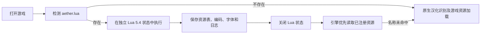

# 游戏目录 Lua 资源接口

简体中文 | [English](README.md)

BGI、YU-RIS、ADVHD、SoftPal、CatSystem2、Escude、SystemC、EntisGLS
共用一套 `aether` Lua 接口，当前
`aether.api_version` 为 `1`。把 UTF-8 编码的 `aether.lua` 放在游戏根目录，
引擎打开游戏时就会读取并执行它；支持带 UTF-8 BOM 的脚本。

这套接口用于在启动阶段准备汉化资源：Lua 负责读取、解析补丁文件，公共层保存
注册结果，各引擎把结果接到自己的资源读取入口。接口名称和调用方式统一；
资源名称、资源的二进制格式和可选编码仍由目标引擎决定。

Lua 是未被引擎原生支持的补丁格式的兜底入口。已支持的汉化包会自动识别，
不需要放置 `aether.lua`：

| 引擎 | 原生汉化识别示例 |
| --- | --- |
| YU-RIS | 游戏根目录内含 YBN 的未加密 XP3；支持 zlib/zstd 索引和资源段，脚本编码沿用 AUTO 严格解码选择。 |
| SoftPal | DLL 的 RT_RCDATA 中带 `STRINGS.JSON` 的 RPCK v1；图片按需解压，UTF-8 译文按原生文本 ID 合并为 CP936，保留未翻译文本，并使用模块引用的本地字体。 |
| BGI | `.chs` 中的 `ChihanaPackerVer2.0` 默认 `AlwaysLoad` 资源层；使用 UTF-8/CP932 回退，显式选择日文时不挂载中文包。可选图片模块和全 CG 存档不自动载入。 |

资源优先级为 **Lua 明确注册的资源 → 原生汉化资源 → 原游戏资源**。
原生识别依据文件签名、索引和资源内容，不依赖游戏目录名；
读取 DLL 中的数据时不执行 DLL。

**执行流程**



每次打开游戏执行一次脚本，包括关闭后重新打开同一款游戏。未捕获的脚本错误会
中止本次启动并丢弃本次脚本已注册的资源，错误信息会带有 `aether.lua` 提示。
脚本执行成功后，资源表在本次会话中保持只读；渲染和音频线程不再调用 Lua。
当前没有热重载、逐次读取回调或逐句文本回调。

**最小示例**

假设已解包的汉化资源放在游戏目录的 `translation/` 中，字体位于
`fonts/chinese.ttf`：

```lua
assert(aether.api_version == 1, "需要 Aether Lua 接口 v1")

aether.mount_dir("translation")
-- 仅在引擎支持且汉化脚本使用 GBK 时调用：
-- aether.set_encoding("GBK")

if aether.exists("fonts/chinese.ttf") then
    aether.set_font("fonts/chinese.ttf")
end

aether.log("汉化资源已加载，引擎：" .. aether.engine)
```

`translation/` 下的路径应与引擎请求的资源名对应。例如 YU-RIS 的
`translation/ysbin/yst00001.ybn` 会注册为 `ysbin/yst00001.ybn`。
换成其他引擎时，仍调用相同的函数，但要提供该引擎能读取的资源。

**统一接口**

下表中函数均位于全局表 `aether`。`bytes` 是 Lua 二进制字符串，可以包含
`\0`；长度、文件偏移和资源大小均按字节计算。

| 字段或函数 | 返回值 | 行为 |
| --- | --- | --- |
| `api_version` | 整数 | 当前为 `1`，供脚本检查接口版本。 |
| `engine` | 字符串 | `bgi`、`yuris`、`advhd`、`softpal`、`catsystem2`、`escude`、`systemc` 或 `entisgls`。供脚本检查或选择处理逻辑。 |
| `read_file(path [, offset [, size]])` | 二进制字符串 | 读取游戏目录内的物理文件。`offset` 默认为 `0`，从零计数；省略 `size` 时读到文件末尾。越界或读取失败会报错。 |
| `exists(path)` | 布尔值 | 检查游戏目录内的物理文件或目录是否存在。路径不合法时会报错。 |
| `add_file(name, bytes)` | 无 | 用逻辑资源名注册字节内容；同名资源后注册的覆盖先注册的。允许空内容。 |
| `mount_dir(path)` | 无 | 递归读取目录内的普通文件并注册，逻辑名称相对于该目录；拒绝目录内容中的符号链接。 |
| `decompress(bytes, format [, size])` | 二进制字符串 | 解压 `zlib` 或 `zstd` 数据。显式传入的解压大小必须匹配结果；zstd 帧没有记录大小时必须提供 `size`。损坏数据会报错。 |
| `transcode(bytes, from [, to])` | 二进制字符串 | 严格转换字符编码，`to` 默认为 `UTF-8`。输入无效或目标编码无法表示字符时会报错。 |
| `set_encoding(name)` | 无 | 指定本次游戏会话的文本编码。在适用的脚本格式中，启动时优先于自动检测和启动器编码设置。各引擎支持范围见下表。 |
| `set_font(path)` | 无 | 选择游戏目录内已存在的物理字体文件；路径校验在脚本阶段完成，字体加载由引擎完成。 |
| `log(message)` | 无 | 记录补丁启动日志，成功加载后由引擎输出。使用它代替 `print`。 |

`read_file` 和 `exists` 查询物理文件，不查询已注册资源表，也不自动读取原引擎
封包内的成员。`set_font` 同样要求物理文件，不能直接引用仅由 `add_file`
注册的虚拟字体。文件偏移从零计数，而 Lua 字符串下标从一计数，解析封包时需
注意这个区别。

**注册内容与优先级**

资源读取优先使用 Lua 注册的同名内容；未命中时继续各引擎原有的资源查找流程。
例如先挂载目录，再覆盖其中一个文件：

```lua
assert(aether.engine == "catsystem2")
aether.mount_dir("translation")
local packed = aether.read_file("patch/scene.cst.zst")
aether.add_file("scene.cst", aether.decompress(packed, "zstd"))
```

`add_file` 保存的是该引擎资源读取入口所需的字节。宿主不会把任意中文文本自动
编译成 YBN、CST 或其他引擎脚本；注册后的资源仍交给原有解析器处理。
`mount_dir` 挂载已解包的目录；对于原生层尚未支持的封包变体，Lua 可以自行
解析索引，再通过 `decompress` 解压并注册资源。

逻辑资源名统一将 ASCII 大写字母转换为小写，将反斜杠转换为 `/`，并归一化
路径。物理文件名保留原始大小写和 Unicode 字符。路径不能包含 `..`、绝对路径、
盘符或 NUL；物理读取解析符号链接后也必须位于游戏目录内。

**引擎适配范围**

| 引擎 | 接入位置及差异 |
| --- | --- |
| BGI | 注册表作为优先资源层，覆盖归档读取与启动资源；脚本明确指定归档名时也会检查覆盖资源。 |
| YU-RIS | 覆盖编译脚本、源码脚本及通用资源路径查询。部分消费者要求文件路径，因此把注册资源写入本会话专属的宿主缓存目录，释放会话资源时清理。 |
| ADVHD | 在资源存在性查询和读取入口优先检查注册表，包括指定归档的读取。 |
| SoftPal | 在资源读取入口优先检查注册表；另支持下述文本 ID 覆盖数据。 |
| CatSystem2 | 在 VFS 的存在性查询、读取、文件复制和资源列表中合并注册资源。 |
| Escude | 接入 VFS 读取、存在性查询、ACPX 源码发现和资源列表；资源名需含原有挂载前缀，例如 `script/main.c`。Lua 使用 UTF-8 名称，引擎内部资源路径仍使用 CP932。流式消费者通过已有缓存读取覆盖内容。 |
| SystemC | 接入 VFS 读取、存在性查询、资源列表和脚本选择；流式消费者通过已有缓存读取覆盖内容，避免绕过覆盖层打开原始散文件。 |
| EntisGLS | 接入 Cotopha 环境中的 CSX 及资源读取，包括 NOA 成员。注册逻辑名，例如 `adventure.csx`；读取时也识别 `storage://game/` 和游戏目录内的绝对路径。覆盖资源写入会话缓存，相对引用仍可回到原封包，释放会话后清理缓存。原生启动配置发现保持不变；排除 `savedata/`，保留已有存档优先级和原生写入行为。 |

Lua 脚本看到的函数完全相同。上述差异由 C++ 适配层处理，游戏无需选择另一套
Lua API。引擎探测和部分启动配置仍可能早于 hook 执行；当前覆盖范围是已经接入
的资源读取路径，不代表能替换任意引擎文件访问或存档读写。

**编码与字体**

| 引擎或脚本类型 | `set_encoding` 支持值 |
| --- | --- |
| BGI | `CP932`、`GBK`、`UTF-8`；UTF-8 使用引擎原有的 CP932 回退规则。 |
| YU-RIS 编译脚本 | `CP932`、`GBK`、`BIG5`、`UTF-8`。 |
| ADVHD 旧版脚本 | `CP932`、`GBK`；现代 ADVHD 脚本保留原生 UTF-8 格式。 |
| SoftPal | `CP932`、`GBK`，其中 `GBK` 在适配层映射为 CP936。 |
| CatSystem2 场景脚本 | `CP932`、`GBK`、`GB18030`、`BIG5`、`UTF-8`。 |
| Escude ACPX 脚本 | `CP932`、`GBK`。 |
| SystemC 脚本 | `CP932`、`GBK`、`UTF-8`。 |
| EntisGLS CSX | 保留原生 Unicode 表示，没有全局字节编码开关；调用 `set_encoding` 会明确报错。资源覆盖、`transcode` 和字体选择仍可使用。 |

`set_encoding` 的名称不区分 ASCII 大小写。`SJIS`、`Shift-JIS`、`Shift_JIS`
归一为 `CP932`，`CP936`、`GB2312` 归一为 `GBK`，`UTF8` 归一为 `UTF-8`。
当前引擎不支持的编码会导致启动失败。未调用时保留原有选择和检测逻辑。

`set_encoding` 决定引擎如何解释资源中的文本字节；`transcode` 则实际转换字节。
例如 `aether.transcode("中文", "UTF-8", "GBK")` 返回 GBK 字节，但不会改变
引擎设置。整体切换编码时，应确保被读取的文本与该编码相符，包括未翻译部分。
字体选择决定字符如何绘制，不承担字符编码转换。
EntisGLS 的 `set_font` 在本会话内优先于脚本指定的字体名，保留原有字号和样式；
关闭会话后恢复原生字体选择。

**SoftPal 的文本 ID 扩展**

部分 SoftPal 汉化把台词保存为“原生文本 ID → 中文”的映射。直接把变长中文
写回原来的 `TEXT.DAT`，会移动文本位置，而原脚本还可能引用旧字节偏移。

因此适配层额外接受逻辑资源 `aether/softpal-text.bin`：脚本通过同一个
`aether.add_file` 注册它，内容是带版本标记的文本 ID 映射。VM 先用原偏移找到
原文本 ID，再读取对应的替换内容，保留原偏移和 ID 的含义。
如果原生 RPCK 已提供同一 ID 的译文，Lua 的 ID 覆盖表优先；未覆盖的 ID 保留
原生译文。RPCK 的原始 DAT 按其原编码解析，再把 Unicode 文本映射转为 CP936，
Lua 文本覆盖表应使用这一最终编码。

这是 SoftPal 专属的数据约定，其他引擎不会自动消费它；没有新增一套 SoftPal
专用 Lua 函数。二进制格式及实际加载示例见 SoftPal 包中的
`aether_runtime/examples/README.zh-CN.md` 和 `totsulover.lua`。

**执行环境与当前取舍**

脚本使用独立 Lua 5.4 状态，可用 base、string、table、math、utf8 库，支持
`string.unpack` 和整数位运算。环境不开放 `io`、`os`、`package`、`debug`，
也不开放 `dofile`、`loadfile`、`load`、`collectgarbage`、`print` 或本地模块加载。
错误可用 `pcall` 捕获；未捕获错误会终止加载。

当前限制为：Lua 源码 1 MiB，单次文件读取或单份资源 256 MiB，Lua 堆 256 MiB，
注册资源累计 512 MiB，最多 65,536 个资源，Lua 指令计数预算约一亿条；日志最多
128 条，每条 4,096 字节。Lua 堆与 C++ 资源表的额度分别计算，并非整个进程的
内存上限。

v1 在启动时一次性读取、解压并保存注册资源，能让运行中的查询保持简单，也能
在进入游戏前发现补丁错误。代价是补丁较大时增加启动时间和内存占用；YU-RIS
和 EntisGLS 还会产生一份文件缓存。当前不提供按需解压、流式资源或运行期间动态回调。

**独立检查脚本**

公共模块提供 `aether_lua_probe`，可在不启动游戏的情况下执行脚本并查看注册数量：

```sh
cmake --build <构建目录> --target aether_lua_probe
<构建目录>/bridge/game_hooks/aether_lua_probe "<游戏目录>" yuris
```

第二个参数应使用上表中的引擎标识。该工具验证 Lua 执行和资源注册；资源内容
能否被目标引擎正确解析、渲染，以及编码是否适合游戏，仍需实际引擎验证。

共用实现位于 `include/AetherGameHooks.h` 与 `src/AetherGameHooks.cpp`。
游戏专属的解包逻辑保留在各引擎包的 Lua 示例里，仓库只保存加载代码，游戏资源
和字体由本地安装提供。
