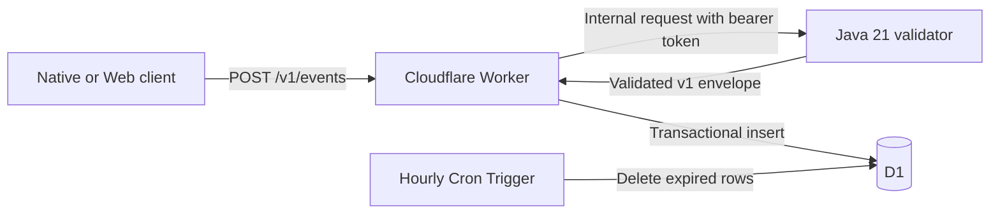

# Aether telemetry ingest

The public Cloudflare Worker accepts telemetry at `POST /v1/events`. A Java 21 service validates the entire request and returns a freshly serialized envelope to the Worker. The Worker writes the validated rows in one D1 transaction and returns `204 No Content` only after it succeeds. The Java service holds no D1 credentials and has no persistent state.



## Protocol v1

Send UTF-8 `application/json` with 1–25 event objects and a total body of at most 65,536 bytes. `charset=utf-8` is optional. Compression, extra keys, duplicate JSON keys, trailing JSON values, and non-integer forms for integer fields are rejected. A malformed event rejects the whole batch.

```json
{
  "schema_version": 1,
  "events": [{
    "event_id": "d4fff625-d1d3-4968-851e-4fd80eebe704",
    "install_id": "8fc20932-10c7-4308-acc3-33fb5bdc1fd8",
    "kind": "app_start",
    "os": "Linux",
    "arch": "x86_64",
    "ram_bucket": "8_15_gb",
    "gpu_family": "intel",
    "app_version": "1.2.3",
    "build": "7fc6116",
    "channel": "github_release",
    "launch_count": 1
  }]
}
```

All ten common event fields in the example are required. Both IDs are lowercase RFC 4122 UUID v4 strings. `install_id` is a client-generated random pseudonymous ID for the installation. It groups events across launches and is distinct from a person, account, or physical device ID. Create a fresh `event_id` for each distinct event and reuse that ID and payload on retries.

| Field | Allowed values |
| --- | --- |
| `os` | `Windows`, `macOS`, `Linux`, `FreeBSD`, `NetBSD`, `OpenBSD`, `BSD`, `Android`, `iOS`, `Web`, `Unknown` |
| `arch` | `x86_64`, `x86_32`, `arm64`, `arm32`, `riscv64`, `riscv32`, `wasm64`, `wasm32`, `unknown` |
| `ram_bucket` | `lt_4_gb`, `4_7_gb`, `8_15_gb`, `16_31_gb`, `32_63_gb`, `gte_64_gb`, `unknown` |
| `gpu_family` | `geforce_rtx`, `geforce_gtx`, `nvidia_rtx`, `nvidia`, `radeon_rx`, `amd`, `intel_arc`, `intel_iris`, `intel_uhd`, `intel`, `apple`, `adreno`, `mali`, `powervr`, `software`, `unknown` |
| `app_version`, `build` | Version and build identifiers matching `[A-Za-z0-9][A-Za-z0-9._+-]{0,63}` |
| `channel`, `engine`, `error_code` | Release channel, runtime identifier, and stable code respectively. Each matches `[a-z0-9][a-z0-9_-]{0,39}`. |

| Kind | Required additional fields | Optional additional fields |
| --- | --- | --- |
| `app_start` | `launch_count` (literal `1`) | |
| `app_usage` | `duration_ms` | `fps`, `memory_peak_mb` |
| `engine_start` | `engine`, `success` (boolean), `load_ms` | `game_name`, `error_code` (only if `success` is `false`) |
| `engine_usage` | `engine`, `duration_ms` | `game_name`, `fps`, `memory_peak_mb` |
| `engine_error` | `engine`, `error_code` | `game_name` |

- `duration_ms` and `load_ms` are integers from 0 to 86,400,000. `fps` is the integer average over the reported measurement interval (0–1,000), and may be omitted or `null` when unavailable. `memory_peak_mb` is peak memory in whole MiB (0–1,048,576). Omit other unavailable optional fields.
- `game_name` may contain 1–120 Unicode code points. Controls, format characters, line/paragraph separators, edge whitespace, `/`, `\`, `:`, `.` and `..` path segments are rejected. The client may supply the displayed library title, which can be a local file or folder basename when metadata is unavailable. Omit unknown titles, full paths, URLs, and text that fails these checks. The validator can check syntax only. Storage treats game names as untrusted text.
- Use a stable error code. Free-form error messages, paths, and other contextual details have no place in the envelope.

Browsers may POST from any origin, including custom Web build hosts, because the endpoint is a public, credentialless write-only API. CORS allows `Content-Type` and omits `Access-Control-Allow-Credentials`. Send browser requests with credentials omitted. CORS does not authenticate telemetry or prevent abuse from scripts outside the browser.

| Status | Meaning |
| --- | --- |
| `204` | The batch is committed, including the case where every event was already present. This also answers valid CORS preflights. |
| `400`, `413`, `415` | Invalid body or content type. Correct or discard the batch before attempting it again. |
| `503` | Validation or storage unavailable. Retry with backoff and the same event IDs. Treat a lost response the same way. |

## Raw events and retention

D1 stores typed fields from the validated envelope, server-assigned `received_at_ms` (UTC Unix milliseconds), and `schema_version`. It stores one row per `event_id` and keeps the first successfully stored payload and receipt time. The same rule applies to repetitions in a single batch and concurrent deliveries. Deduplication lasts while the row exists.

An `app_start` row is one reported launch. App and engine usage rows are separate streams of reported incremental durations and can overlap, so analyze them separately. Average FPS and peak memory are per-event measurements. `engine_start` records the reported outcome and load time of an attempt. `engine_error` records a separately reported error and can describe the same underlying failure as an `engine_start` row. Receipt time is the upload time and can differ from event time. Public ingest data represents unverified client reports.

The hourly Cron Trigger deletes rows more than 90 days old, measured by first receipt time. It deletes in indexed chunks of 5,000, up to 50,000 expired rows per invocation. Monitor scheduled invocation failures and expiry backlog and adjust capacity if expiry exceeds that rate. Rows normally disappear within one hour after their 90-day cutoff. D1's managed [Time Travel](https://developers.cloudflare.com/d1/reference/time-travel/) recovery history has its own retention window and can contain deleted rows until it expires. Keep raw exports subject to the same access and retention requirements.

The application stores no client IP, headers, local file paths, request logs, or unvalidated payload. The Worker constructs the internal request from a fixed destination and its own `Authorization` and `Content-Type` headers. It ignores public authorization, cookies, and forwarding headers. Keep Workers observability, request/HTTP Logpush, and reverse-proxy access logs disabled for telemetry traffic. Cloudflare and the hosting provider still process network metadata for transport and platform security. Restrict D1 access to operators who need raw data.

### Aggregate queries

Run the included operator queries against local D1, or use `--remote` and the corresponding production configuration. The Worker has no reporting endpoint.

```sh
wrangler -c wrangler.local.toml d1 execute TELEMETRY_DB --local --file queries/daily_usage.sql
wrangler -c wrangler.local.toml d1 execute TELEMETRY_DB --local --file queries/engine_startup.sql
wrangler -c wrangler.local.toml d1 execute TELEMETRY_DB --local --file queries/performance.sql
wrangler -c wrangler.local.toml d1 execute TELEMETRY_DB --local --file queries/engine_errors.sql
```

Daily usage uses UTC receipt dates and counts distinct reporting installations. Engine startup groups attempts and successes by engine and title. Performance reports duration-weighted FPS where sampled and the maximum of reported memory peaks. Memory measurement depends on platform. Native reports sampled process usage, and Web may report WebAssembly memory capacity. Compare like measurements. Error counts separate startup failures from standalone error events.

## Local development and tests

Use a Java 21 JDK, `curl`, `sha256sum`, Node.js and Wrangler 4.168.0. The Java build downloads the pinned, SHA-256-verified Jackson Core dependency from Maven Central. The local Worker uses a loopback Java process, a public development-only bearer fixture, and emulated D1. No Docker or Cloudflare account credentials are needed.

From `services/telemetry`, in terminal one:

```sh
./java/build.sh
TELEMETRY_ORIGIN_SECRET=local-dev-only-aether-telemetry-v1-test ./java/run.sh
```

In terminal two:

```sh
wrangler -c wrangler.local.toml d1 migrations apply TELEMETRY_DB --local
wrangler -c wrangler.local.toml dev --local --ip 127.0.0.1 --test-scheduled
```

Send requests to `http://127.0.0.1:8787/v1/events`. Read local rows with `wrangler -c wrangler.local.toml d1 execute TELEMETRY_DB --local --command 'SELECT * FROM telemetry_events'`. `GET /__scheduled` invokes pruning in this local test mode.

Run the integration suite with Python 3:

```sh
python3 tests/integration.py
```

The suite compiles Java, applies the migration to a temporary D1 database, starts both servers on loopback, and tests malformed inputs, CORS, origin auth, both ingress size limits, all five event kinds, all-or-nothing validation, duplicate events, D1 failure, and expiration. Set `JAVA_HOME` to the JDK path and `WRANGLER` to the CLI path if they are outside `PATH`. Set `TMPDIR` for temporary build and D1 state, or `TELEMETRY_BUILD_DIR` to relocate a manual Java build. This suite exercises the Worker and Java protocol via the HTTP origin mode.

## Production deployment

Use one Worker deployment mode per environment. A new environment needs its own Worker name, D1 database name and ID, and random origin secret. Set the public endpoint to HTTPS and disable request logging before sending client traffic.

For a public rollout, use a custom domain with a zone rate limit for `/v1/events` and disable the `workers.dev` route once that domain is active. In the Cloudflare security dashboard, match the telemetry hostname and path (or the path alone if the plan permits only that field), count by IP at the edge, and select the block action. Start with a limit such as 60 requests per 10 seconds per IP, then tune it based on aggregate traffic and shared networks. Confirm that the client retries throttled requests and leaves event IDs unchanged. Monitor Worker, Container, and D1 usage against plan limits. [Cloudflare WAF rate limiting rules](https://developers.cloudflare.com/waf/rate-limiting-rules/)

### Cloudflare Containers

The default configuration uses a stateless Java container reached through an internal Durable Object binding. The instance is started on demand, has outbound Internet access disabled at runtime, and sleeps after two idle minutes. This mode requires a Workers Paid plan with [Cloudflare Containers](https://developers.cloudflare.com/containers/get-started/) plus Docker for the first and subsequent Dockerfile builds.

1. Run `wrangler login` and `wrangler d1 create aether-telemetry`. Set the ID returned by Cloudflare as `database_id` in [wrangler.toml](<wrangler.toml>).
2. Generate a secret with `openssl rand -hex 32` and store it securely. Run `wrangler secret put TELEMETRY_ORIGIN_SECRET` and supply the secret. The Durable Object supplies it to Java at startup. After changing the secret, allow the old Java instance to go idle and stop before resuming traffic to let it boot with the new value.
3. Run `wrangler d1 migrations apply TELEMETRY_DB --remote`, then `wrangler deploy`. The container may take time to provision after its first deploy. Send a fixture to the deployed HTTPS `/v1/events` endpoint and verify the row with a D1 query. Confirm successful scheduled invocations in the Cloudflare dashboard.

### Existing Java host over verified HTTPS

This mode uses the same Worker/D1 code and Java validator with [wrangler.origin.toml](<wrangler.origin.toml>). No Cloudflare Container is required. Build with `./java/build.sh`, deploy the Java `build/` files and launcher, and run `./java/run.sh` under a service manager with `TELEMETRY_ORIGIN_SECRET`. Java listens on `127.0.0.1:8080` by default. The optional `TELEMETRY_BIND` and `TELEMETRY_PORT` variables configure the private listener.

Expose only `POST /internal/v1/validate` through a TLS reverse proxy to Java. Use a trusted TLS certificate for the origin hostname and a dedicated ingress hostname. Keep access/header logs off, strip client IP and forwarding headers before proxying, and restrict network access where your host permits it. When using a Cloudflare-proxied origin, use Full (strict) TLS and ensure the origin hostname routes to the Java proxy. The Worker sets `X-Real-IP` to a fixed placeholder for HTTPS requests, disallows redirects, and requires TLS except in explicit loopback dev mode. Platform headers can vary with the network path. See [Cloudflare's subrequest header behavior](https://developers.cloudflare.com/fundamentals/reference/http-headers/#cf-connecting-ip-in-worker-subrequests).

Set `TELEMETRY_ORIGIN_URL` to the base HTTPS URL (hostname and optional port). Set the real `database_id` and configure the same random `TELEMETRY_ORIGIN_SECRET` as a Worker secret and Java environment variable. Add `--config wrangler.origin.toml` to `wrangler secret put TELEMETRY_ORIGIN_SECRET`, `wrangler d1 migrations apply TELEMETRY_DB --remote`, and `wrangler deploy`. The proxy and Java must be reachable by the Worker before enabling client traffic.
