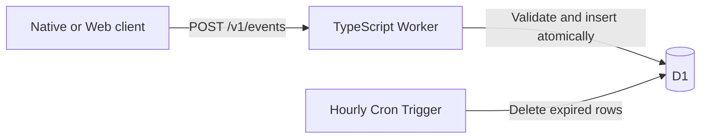

# Aether telemetry ingest

The TypeScript Cloudflare Worker accepts telemetry at `POST /v1/events`, validates every event in the batch, and commits the validated rows to D1. It returns `204 No Content` after D1 commits the batch.



## Protocol v1

Send UTF-8 `application/json` with 1–25 event objects and a total body of at most 65,536 bytes. `charset=utf-8` is optional. Compression, extra keys, duplicate JSON keys, trailing JSON values, and non-integer forms for integer fields are rejected. A malformed event rejects the whole batch.

```json
{
  "schema_version": 1,
  "events": [{
    "event_id": "d4fff625-d1d3-4968-851e-4fd80eebe704",
    "install_id": "8fc20932-10c7-4308-acc3-33fb5bdc1fd8",
    "kind": "app_start",
    "os": "Linux",
    "arch": "x86_64",
    "ram_bucket": "8_15_gb",
    "gpu_family": "intel",
    "app_version": "1.2.3",
    "build": "7fc6116",
    "channel": "github_release",
    "launch_count": 1
  }]
}
```

All ten common event fields in the example are required. Both IDs are lowercase RFC 4122 UUID v4 strings. `install_id` is a client-generated random pseudonymous ID for the installation. It groups events across launches and is distinct from a person, account, or physical device ID. Create a fresh `event_id` for each distinct event and reuse that ID and payload on retries.

| Field | Allowed values |
| --- | --- |
| `os` | `Windows`, `macOS`, `Linux`, `FreeBSD`, `NetBSD`, `OpenBSD`, `BSD`, `Android`, `iOS`, `Web`, `Unknown` |
| `arch` | `x86_64`, `x86_32`, `arm64`, `arm32`, `riscv64`, `riscv32`, `wasm64`, `wasm32`, `unknown` |
| `ram_bucket` | `lt_4_gb`, `4_7_gb`, `8_15_gb`, `16_31_gb`, `32_63_gb`, `gte_64_gb`, `unknown` |
| `gpu_family` | `geforce_rtx`, `geforce_gtx`, `nvidia_rtx`, `nvidia`, `radeon_rx`, `amd`, `intel_arc`, `intel_iris`, `intel_uhd`, `intel`, `apple`, `adreno`, `mali`, `powervr`, `software`, `unknown` |
| `app_version`, `build` | Version and build identifiers matching `[A-Za-z0-9][A-Za-z0-9._+-]{0,63}` |
| `channel`, `engine`, `error_code` | Release channel, runtime identifier, and stable code respectively. Each matches `[a-z0-9][a-z0-9_-]{0,39}`. |

| Kind | Required additional fields | Optional additional fields |
| --- | --- | --- |
| `app_start` | `launch_count` (literal `1`) | |
| `app_usage` | `duration_ms` | `fps`, `memory_peak_mb` |
| `engine_start` | `engine`, `success` (boolean), `load_ms` | `game_name`, `error_code` (only if `success` is `false`) |
| `engine_usage` | `engine`, `duration_ms` | `game_name`, `fps`, `memory_peak_mb` |
| `engine_error` | `engine`, `error_code` | `game_name` |

- `duration_ms` and `load_ms` are integers from 0 to 86,400,000. `fps` is the integer average over the reported measurement interval (0–1,000), and may be omitted or `null` when unavailable. `memory_peak_mb` is peak memory in whole MiB (0–1,048,576). Omit other unavailable optional fields.
- `game_name` may contain 1–120 Unicode code points. Controls, format characters, line/paragraph separators, edge whitespace, `/`, `\`, `:`, `.` and `..` path segments are rejected. The client may supply the displayed library title, which can be a local file or folder basename when metadata is unavailable. Omit unknown titles, full paths, URLs, and text that fails these checks. The validator can check syntax only. Storage treats game names as untrusted text.
- Use a stable error code. Free-form error messages, paths, and other contextual details have no place in the envelope.

Browsers may POST from any origin, including custom Web build hosts, because the endpoint is a public, credentialless write-only API. CORS allows `Content-Type` and omits `Access-Control-Allow-Credentials`. Send browser requests with credentials omitted. CORS does not authenticate telemetry or prevent abuse from scripts outside the browser.

| Status | Meaning |
| --- | --- |
| `204` | The batch is committed, including the case where every event was already present. This also answers valid CORS preflights. |
| `400`, `413`, `415` | Invalid body or content type. Correct or discard the batch before attempting it again. |
| `429` | The edge throttled the request. Respect `Retry-After` and reuse the same event IDs. |
| `503` | Validation or storage unavailable. Retry with backoff and the same event IDs. Treat a lost response the same way. |

## Raw events and retention

D1 stores typed fields from the validated envelope, server-assigned `received_at_ms` (UTC Unix milliseconds), and `schema_version`. It stores one row per `event_id` and keeps the first successfully stored payload and receipt time. The same rule applies to repetitions in a single batch and concurrent deliveries. Deduplication lasts while the row exists.

An `app_start` row is one reported launch. App and engine usage rows are separate streams of reported incremental durations and can overlap, so analyze them separately. Average FPS and peak memory are per-event measurements. `engine_start` records the reported outcome and load time of an attempt. `engine_error` records a separately reported error and can describe the same underlying failure as an `engine_start` row. Receipt time is the upload time and can differ from event time. Public ingest data represents unverified client reports.

The hourly Cron Trigger deletes rows more than 90 days old, measured by first receipt time. It deletes in indexed chunks of 5,000, up to 50,000 expired rows per invocation. Monitor scheduled invocation failures and expiry backlog and adjust capacity if expiry exceeds that rate. Rows normally disappear within one hour after their 90-day cutoff. D1's managed [Time Travel](https://developers.cloudflare.com/d1/reference/time-travel/) recovery history has its own retention window and can contain deleted rows until it expires. Keep raw exports subject to the same access and retention requirements.

The application stores no client IP, headers, local file paths, request logs, or unvalidated payload. The Worker uses the Cloudflare-provided IP transiently for its rate limiter. It ignores public authorization, cookies, and forwarding headers. Keep Workers observability and request Logpush disabled for telemetry traffic. Cloudflare processes network metadata for transport and platform security. Restrict D1 access to operators who need raw data.

### Aggregate queries

Run the included operator queries against local D1, or use `--remote` and the corresponding production configuration. The Worker has no reporting endpoint.

```sh
wrangler -c wrangler.local.toml d1 execute TELEMETRY_DB --local --file queries/daily_usage.sql
wrangler -c wrangler.local.toml d1 execute TELEMETRY_DB --local --file queries/engine_startup.sql
wrangler -c wrangler.local.toml d1 execute TELEMETRY_DB --local --file queries/performance.sql
wrangler -c wrangler.local.toml d1 execute TELEMETRY_DB --local --file queries/engine_errors.sql
```

Daily usage uses UTC receipt dates and counts distinct reporting installations. Engine startup groups attempts and successes by engine and title. Performance reports duration-weighted FPS where sampled and the maximum of reported memory peaks. Memory measurement depends on platform. Native reports sampled process usage, and Web may report WebAssembly memory capacity. Compare like measurements. Error counts separate startup failures from standalone error events.

## Local development

Use Node.js 24, Wrangler 4.168.0 and Python 3. To type-check, install TypeScript 6.0.3 and generate the Worker declarations.

```sh
wrangler types
tsc --project tsconfig.json
node --test tests/edge.test.mjs
python3 tests/integration.py
```

For a local server with a persistent database, from this directory run:

```sh
wrangler -c wrangler.local.toml d1 migrations apply TELEMETRY_DB --local
wrangler -c wrangler.local.toml dev --local
```

The integration test runs against its own temporary D1 database. It covers CORS, malformed or oversized requests, idempotency, transaction rollback, retention, and the aggregate queries.

## Production deployment

The included [production configuration](<wrangler.toml>) targets the Aether Cloudflare account and a D1 database provisioned in APAC. For a separate deployment, choose a distinct Worker and database and replace the database name and ID before deploying. Register a `workers.dev` subdomain or configure a custom hostname.

```sh
wrangler d1 migrations apply TELEMETRY_DB --remote
wrangler deploy
```

Verify a synthetic event in D1 and check the scheduled trigger in Cloudflare. The rate limiter applies an approximate limit of 60 requests per 10 seconds per source IP in each Cloudflare location. Monitor Workers and D1 usage as the rollout grows. Set `AETHER_TELEMETRY_ENDPOINT` in client builds to the verified HTTPS endpoint. Release packaging uses the GitHub Actions repository variable of the same name. See the [client build guide](<../../doc/telemetry-build.md>).
